# BC-250 REMOTE PSU POWER CONTROLLER
ESP32 2-Channel 5V Relay Module-based device for remote control of the BC-250 atx power supply with web interface and PS5 controller support.


Key Features

Remote Power Control: Turn PC on/off via web interface or physical button
PS5 Controller Integration: Use DualSense controller to power on PC with PS button
WiFi Configuration: Web-based setup with network scanning
MAC Address Locking: Restrict controller access to specific devices
Over-the-Air Updates: Firmware updates via web interface

# Hardware

This build replaces the ready-made dual-relay module with a 23 x 18-hole
protoboard: an ESP32 DevKit (30-pin) on socket strips, two SRD-05VDC-SL-C
relays salvaged from a dead module, and the original 6-way and 3-way terminal
blocks.



| Part | Value |
|---|---|
| Relay drivers Q1, Q2 | S8050 NPN (E-B-C, flat face toward row 1) |
| Base resistors R1, R2 | 1 kOhm |
| Flyback diodes D1, D2 | 1N4007, band on the +5 V coil pin |
| LED data resistor R3 | 470 Ohm |
| Wire | 22 AWG solid core |

| ESP32 pin | Connects to |
|---|---|
| GPIO 16 | Relay 1: COM to PSU PS_ON (green), NO to PSU ground |
| GPIO 17 | Relay 2: COM to BC-250 power pin P, NO to TPMS1 pin 17 (GND) |
| GPIO 4 | TPMS1 pin 9 (3 V) through 1 kOhm, PC-on sense |
| GPIO 22 | Momentary power button to GND |
| GPIO 23 | Button LED through 220 Ohm |
| GPIO 18 | LED strip DIN through R3 |
| GPIO 25 | SC8002B speaker amplifier S input (no firmware support yet) |

The board runs from the PSU's 5 V standby rail on the 3-way terminal. The LED
strip's + and - are wired straight to that terminal, so its current never
passes through the DevKit.

# Installation

Before installing libraries, you need to add the [ESP32_bluepad32](https://github.com/ricardoquesada/bluepad32) platform to your Arduino IDE.

Open Arduino IDE.
Go to File > Preferences (or Arduino IDE > Settings on macOS).
In the "Additional Boards Manager URLs" field, paste the following URL:
```
    https://raw.githubusercontent.com/espressif/arduino-esp32/gh-pages/package_esp32_index.json ,https://raw.githubusercontent.com/ricardoquesada/esp32-arduino-lib-builder/master/bluepad32_files/package_esp32_bluepad32_index.json 
```

Go to Tools > Board > Boards Manager.
In the search bar, type "esp32_bluepad32".


# Install libraries
- [LittleFS (for ESP32)](https://github.com/lorol/LITTLEFS) 
- ArduinoJson 7.x (7.4.3 was used for the build)
- [NeoPixelBus by Makuna](https://github.com/Makuna/NeoPixelBus) 2.8.0 or newer (2.8.4 was used for the build), only needed for the LED bar. Earlier releases lack the ESP32 Arduino 3.x RMT support that `esp32-bluepad32` core 4.1.0 is built on, so they will not compile


# LED Bar (optional)

Mirrors the Steam Machine LED bar on a WS2812B strip driven by this ESP32, so
one device handles both power control and the LED bar. When no stream is live
the strip shows power-state animations instead. This feature has not yet been
verified on hardware.

The project keeps using `StaticJsonDocument` from ArduinoJson 7.x for
consistency with its existing config functions. It is deprecated in v7 but
still functional.

## Flash budget

Program storage is roughly 95% of the 1.31 MB app partition, about 64 KB free
(re-check with the compile output rather than trusting this note). OTA
still works because the image fits the app partition. If a future feature
overflows, switch the partition scheme to "Minimal SPIFFS (1.9MB APP with OTA)":
it raises the app partition by roughly 600 KB, the `data/` folder is only about
43 KB so the smaller filesystem is ample, and OTA is preserved.

## Strip length

Supported strip length is 1-24 LEDs (default 8). The Valve LED bar has 17
pixels, fixed by hardware. The firmware stretches those 17 across your strip
with linear interpolation, and the first and last strip LEDs map exactly onto
the first and last source pixel.

## Wiring

| ESP32 pin | Connection |
|---|---|
| GPIO 18 | WS2812B DIN, through a 74AHCT125 level shifter (see below) |
| GND | strip GND, shared with the external supply ground |
| 5V | not for the strip - power the strip from an external 5 V supply (see the power note). The ESP32's own 5V pin is only viable for a handful of LEDs on the bench |

Power: at 24 LEDs an external 5 V supply is required, not merely advisable.
Full white is roughly 1.4 A, which is beyond the dev board's regulator. Power
the strip from the external supply and share its ground with the ESP32.

### Data line

The WS2812B datasheet puts the logic-high threshold at 0.7 x VDD, which is
3.5 V at VDD = 5 V, so a 3.3 V ESP32 GPIO is below spec.

- **Recommended: a 74AHCT125 level shifter.** It translates the 3.3 V output to
  proper 5 V logic. Wire GPIO 18 to 1A (pin 2), /1OE (pin 1) to GND, VCC
  (pin 14) to 5 V, GND (pin 7) to GND, and 1Y (pin 3) through a series
  resistor of 300-500 ohm (470 is ideal, 220 works) to DIN.
- **Alternative: a supply-side voltage drop.** One diode in series with the
  strip's **+5 V rail** (not the data line) lowers VDD to about 4.3 V and the
  threshold to about 3.0 V, bringing 3.3 V data inside spec. That diode carries
  the full strip current, so for 24 LEDs use a Schottky rated 2 A or more, such
  as a 1N5820. A 1N4148 is not suitable.
- **Do not put a diode in series with the data line.** It lowers the logic high
  further and makes the threshold margin worse.

Many clone strips happen to work with 3.3 V data at VDD = 5 V on short runs.
That is luck rather than design, and it is the first thing to suspect if
colours are unstable or the first LED misbehaves.

A bulk capacitor across the strip's VCC/GND, mounted **at the first LED**, is
recommended but not required. It absorbs the current steps the strip demands
when content changes abruptly; without it the failure mode is flicker on bright
transitions, never damage.

1000 uF is the commonly quoted figure, but it assumes a weak supply and a long
run. On a stiff source such as an ATX 5VSB rail, with a short supply run and
`maxBrightness` holding the draw down, 100-220 uF is enough -- and several
smaller capacitors in parallel work as well as one large one. Placement matters
more than value: 100 uF at the first LED beats 1000 uF back at the supply.
Starting with none is a reasonable bench shortcut; add one if you see flicker.

## Host side

Install [steamos-led-wled](https://github.com/rpf16rj/steamos-led-wled) on the
BC-250 and point it at this device:

```bash
git clone https://github.com/rpf16rj/steamos-led-wled.git
cd steamos-led-wled
sudo ./install.sh
```

In `/etc/steamos-led-wled.conf` set `wled_host` to the ESP32's IP address.

**Set `num_leds` to your strip length, capped at 17** (`min(strip length, 17)`).
For a 24-LED strip that means `num_leds = 17`, and the firmware stretches the 17
pixels across all 24. For a strip shorter than 17 it means the strip length, and
the bridge downsamples the Valve bar to fit. **Never set it above 17.** The
bridge reads a fixed 100-byte snapshot of the Valve LED bar, and
`extract_pixels()` indexes `snapshot[32 + i*4]`. At pixel 17 that reads offset
100 and Python raises `IndexError`, which kills the service instead of lighting
more LEDs. There is no validation to warn you. The strip length itself is
configured in the web UI.

Only the **DRGB** protocol mode is supported (WARLS, DRGBW and DNRGB packets are
ignored). Because DRGB is the standard WLED realtime protocol, HyperHDR,
Hyperion and Prismatik can also drive the strip. The device listens on UDP
port 21324.

## Configure

Open `http://<esp-ip>/setup` and use the **LED Bar** card to set the LED count
(1-24), maximum brightness and colour order.

`data/setup.html` is served from LittleFS, so a sketch-only flash or OTA leaves
the old page with no LED card. Upload the filesystem separately, via the
`/update-fs` endpoint or the Arduino IDE's LittleFS upload tool.

Cheap clone WS2812B strips do not always use GRB order. Test strip shows red,
then green, then blue for one second each, but it is remapped through the
**saved** colour order, so do not simply pick what you saw. Use this procedure:

1. The bar must be enabled and saved. Test strip uses the saved colour order,
   not whatever the dropdown currently shows, and does nothing while the bar
   is disabled.
2. With the **saved** order set to GRB (the default), click Test strip. If you see red,
   then green, then blue, your strip is GRB and you are done.
3. Otherwise set the order to **RGB**, save, and test again. The order of the
   three colours you now see **is** your strip's channel order - for example
   green, red, blue means GRB. Select that order and save.
4. Test once more to confirm you now see red, then green, then blue.

## Test tool

`tools/drgb_test.py` sends DRGB packets directly to the ESP32:

```
python tools/drgb_test.py <esp-ip> solid <r> <g> <b> [leds]
python tools/drgb_test.py <esp-ip> rainbow [seconds] [leds]
python tools/drgb_test.py <esp-ip> soak [seconds] [leds]
python tools/drgb_test.py <esp-ip> malformed
```

`[leds]` is the pixel count per packet. It defaults to 8 and is clamped to
1-24. Packets shorter than the strip are resampled by the firmware, so the
default 8-pixel test still lights the whole strip. A packet longer than the
strip is **cropped** to the first N pixels, not downsampled, so a strip shorter
than the packet shows only its left part. The fix is to set the sender's pixel
count (the bridge's `num_leds`, or `[leds]` here) to the strip length.

## Troubleshooting

| Problem | Cause |
|---|---|
| Strip breathes blue and never shows Game Mode colours | The bridge is not streaming. Check `sudo systemctl status steamos-led-wled` on the BC-250 |
| steamos-led-wled stops right after you edit its config | `num_leds` was set above 17. Set it to your strip length, at most 17 |
| Colours wrong (red shows as green, etc.) | Clone colour order. Follow the colour-order procedure above |
| First LED flickers or colours are unstable | No 74AHCT125 level shifter (or supply-side voltage drop), or no shared ground |
| Strip dim but correct | `Max brightness` is low, or the strip is underpowered - use an external 5 V supply |
| Nothing at all | Confirm the strip is enabled in the web UI and `droppedPackets` is not climbing (wrong protocol mode) |

# SETUP Notes
- WIFI AP mode is laggy, be patient. IP: http://192.168.4.1
- https not work!
- MAC-Lock in setup. Lock current cotroller button, is use short time when controller is connected to esp32, be quick.
- Testing without TPMS1 pin 9 connected causes instability.
  
- 

Web
